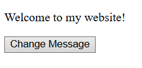
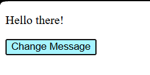
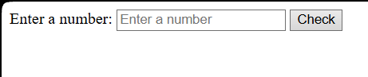
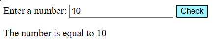
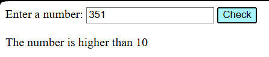
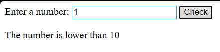
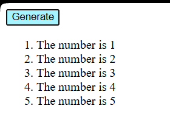

# BIC21203 Web Development — Lab #4a: Client-Side Scripting (JavaScript)

**Name:** PAVINNESS A/L MURUGAIAH  
**Matric / Student ID:** CI250036 
**Course / Section:** BIC21203 — Section 3

## Overview
This repository contains my solutions for Lab #4a[cite: 1], focusing on modern client-side JavaScript fundamentals including functions, `addEventListener()` event handling, input validation, `for` loops, and safe DOM manipulation using `textContent` and `createElement()`[cite: 1].

## Project Structure
* `q1/` — Interactive Text Changer (`index.html`, `script.js`)
* `q2/` — Smart Number Validator (`index.html`, `script.js`)
* `q3/` — Dynamic Number Generator (`index.html`, `script.js`)

## How to Run Each Question
1. Download or clone this repository to your local machine.
2. **Question 1 (Interactive Text Changer):** Open `q1/index.html` in any modern desktop browser. Click the **Change Message** button to update the paragraph text from `"Welcome to my website!"` to `"Hello there!"`.
3. **Question 2 (Smart Number Validator):** Open `q2/index.html` in your browser. Enter a value (e.g., `5`, `10`, `15`, `10.5`, `abc`, or leave it blank) and click **Check** to view the validation message.
4. **Question 3 (Dynamic Number Generator):** Open `q3/index.html` in your browser. Click **Generate** to display an ordered list from 1 to 5 without duplicating items on repeated clicks.

## Output Screenshots

### Question 1 — Interactive Text Changer

### Question 2 — Smart Number Validator

### Question 3 — Dynamic Number Generator

